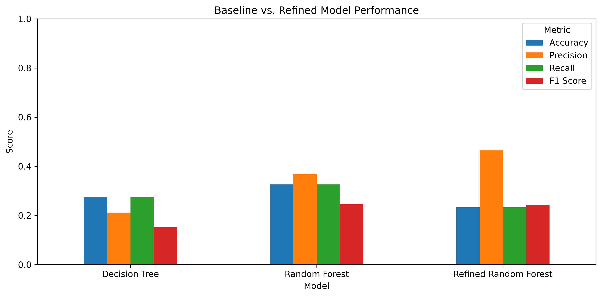
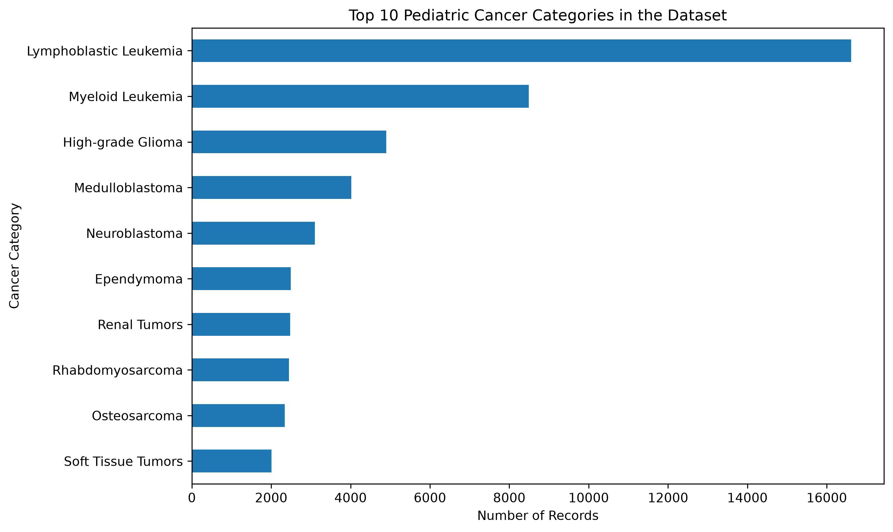

# Pediatric Cancer Research Capstone

## Project Overview

My capstone project focuses on the question:

**Are pediatric cancers with a greater disease burden receiving a similar amount of research attention compared to other pediatric cancers?**

I chose this topic because I interned at the Pediatric Cancer Foundation of the Lehigh Valley. That experience made me more interested in pediatric cancer research and the differences in attention that different cancers receive.

My overall goal is to compare pediatric cancer burden, including survival information, with research attention, such as clinical trials and published studies.

## Data Sources

For my current analysis, I am using `SAMPLE_INFO.tsv`, which contains 158,652 records and 44 columns of pediatric cancer sample information.

I have also explored SEER survival data as another possible source for measuring cancer burden. The SEER files I currently have contain analysis settings rather than the actual survival results, so they have not been included in my models yet.

My raw data is stored in `data/raw/` on my computer and is not included in the GitHub repository.

## Data Cleaning

Before modeling, I checked the dataset for duplicate records and missing values.

I made the following changes:

- Removed records where pediatric cancer diagnosis was listed as "Not Applicable."
- Converted age at diagnosis from text to numerical values.
- Filled missing ages with the median age.
- Kept "Not Available" as a category for missing sex information.
- Removed tissue type because all remaining records were labeled as tumor.

After removing records without a usable cancer diagnosis category, I had **62,630 records** for modeling.

## Feature Engineering

My target variable was pediatric cancer diagnosis category.

I used three features to predict the diagnosis category:

- Age at diagnosis
- Sex
- Sequencing type

I converted sex and sequencing type into dummy variables so they could be used in my models.

I then divided the data into **80% training and 20% testing**. I used a stratified split to help keep the distribution of cancer categories similar in both sets.

## Models

I tested three different models to see which approach worked best.

### 1. Decision Tree

My first model was a decision tree classifier with a maximum depth of 5. I chose this as my baseline because it was simple and gave me a starting point for comparison.

### 2. Random Forest

My second model was a random forest classifier with 100 trees and a maximum depth of 10. I wanted to see whether using multiple decision trees would improve the predictions.

### 3. Refined Random Forest

For my third model, I adjusted the random forest to use 150 trees, a maximum depth of 15, and balanced class weights.

I made these changes to see whether the model could better handle the differences in the number of records for each cancer category.

## Model Evaluation

I compared the models using accuracy, weighted precision, weighted recall, and weighted F1 score.

| Model | Accuracy | Precision | Recall | F1 Score |
|---|---:|---:|---:|---:|
| Decision Tree | 27.5% | 21.2% | 27.5% | 15.2% |
| Random Forest | 32.6% | 36.8% | 32.6% | 24.5% |
| Refined Random Forest | 23.4% | 46.5% | 23.4% | 24.3% |

### Model Comparison Visualization



The original random forest performed the best overall, with an accuracy of 32.6% and an F1 score of 24.5%.

The refined random forest had the highest weighted precision at 46.5%, but its accuracy dropped to 23.4%. This showed me that changing the model settings did not necessarily improve the overall results.

## Key Findings

One of the biggest things I noticed is that the cancer categories are not evenly represented in my dataset. Some cancer types have thousands of records, while others have very few.

This imbalance may be contributing to the models struggling with less common cancer categories.

My results also show that age at diagnosis, sex, and sequencing type alone are not enough to accurately predict all of the different pediatric cancer categories.

The models are useful for testing my data pipeline and comparing different approaches, but they do not directly answer my main research question about disease burden and research attention yet.

## Limitations

My project still has some limitations:

- The dataset has a large imbalance between cancer categories.
- Some values were missing or marked as unavailable.
- My current models do not include disease burden or research attention measurements.
- Missing ages were filled before the train-test split, which may cause some data leakage.
- I have compared and adjusted models using the same test set, so the results should be treated as preliminary rather than a fully independent final evaluation.

These are areas I want to improve before my final submission.

## Next Steps

Before the final version of my capstone, I want to:

1. Continue working with SEER data to include survival or other disease burden information.
2. Add research attention data, such as clinical trial or publication counts.
3. Match cancer categories across the different datasets.
4. Improve my model evaluation and create visualizations that connect more directly to my research question.

## Project Structure

```text
Lia-Capstone/
├── data/
│   ├── raw/                    # Raw data stored locally
│   └── processed/
├── images/
│   └── model_comparison.png
├── notebooks/
│   └── 01_data_exploration.ipynb
├── reports/
├── src/
├── .gitignore
├── README.md
└── requirements.txt
```


## How to Run the Project

To run this project, first clone the GitHub repository:

```bash
git clone https://github.com/liacodes4/Lia-Capstone.git
cd Lia-Capstone
```

Create and activate a Python virtual environment:

```bash
python3 -m venv .venv
source .venv/bin/activate
```

Install the required packages:

```bash
python -m pip install -r requirements.txt
python -m pip install ipykernel
```

### Required Dataset

The notebook uses a file called `SAMPLE_INFO.tsv`.

This file is not included in the GitHub repository because
of its size. It needs to be obtained separately and placed
in the following location:

`data/raw/SAMPLE_INFO.tsv`

The original dataset source and download instructions still
need to be documented.

### Running the Notebook

1. Open the project folder in VS Code.
2. Open `notebooks/01_data_exploration.ipynb`.
3. Select the Python environment from `.venv`.
4. Run the notebook cells from top to bottom.

### Reproducibility Check

I tested my project by cloning the repository into a
separate folder and setting up a new Python environment.

The project ran successfully after I copied the raw dataset
into the correct folder.

This showed me that the code and environment setup worked,
but someone using my repository would still need access
to the original dataset.

## Current Project Status

This is my week 7 capstone draft. My data cleaning, feature engineering, and model comparison are complete. I am continuing to work on connecting my current analysis to my overall research question before the final submission.


### Cancer Category Distribution



This graph shows that some pediatric cancer categories have
more records than others. This imbalance is one possible
reason why my models struggle with less common categories.

These counts represent records in my sample dataset, not
the number of children diagnosed with each cancer.

